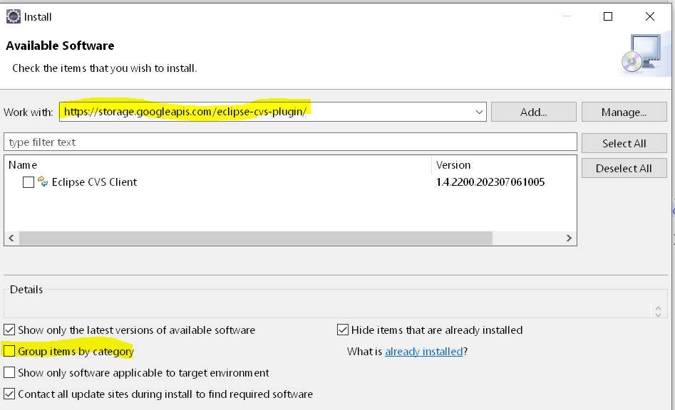

# Eclipse CVS Client

This is the original Eclipse CVS Client plugin extracted from the now empty [eclipse.platform.team](https://github.com/eclipse-platform/eclipse.platform.team) repository. The Eclipse Team stopped maintaining the plugin and removed it from the Eclipse code base in 2022. The rest of the Eclipse Team sources were moved to [Eclipse core](https://github.com/eclipse-platform/eclipse.platform). This git repository is a copy of the eclipse.platform.team repository so it preserves the commits history of the plugins sources.

Update sites URL: 
- `https://storage.googleapis.com/eclipse-cvs-plugin/2026-12`
- `https://storage.googleapis.com/eclipse-cvs-plugin/2026-09`
- older `https://storage.googleapis.com/eclipse-cvs-plugin`



## Build the installable ZIP

Use Python 3.8 or newer, Java 25 (on PATH or via JAVA_HOME), and an unpacked Eclipse SDK 4.42. From the repository root run

```sh
python3 site/or.eclipse.team.cvs-site/build-site.py /path/to/eclipse eclipse-cvs-2026-12.zip
```

The script uses the current UTC minute (YYYYMMDDHHMM) as the build qualifier. To reproduce a version, supply its timestamp between the SDK path and the ZIP path. Use distinct qualifiers for published builds. The script compiles the bundles with the SDK compiler and runs the SDK p2 publisher with the categories from site.xml. To install the ZIP, open **Help → Install New Software… → Add… → Archive…**.
